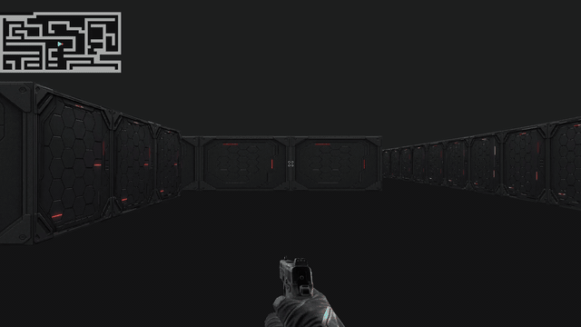
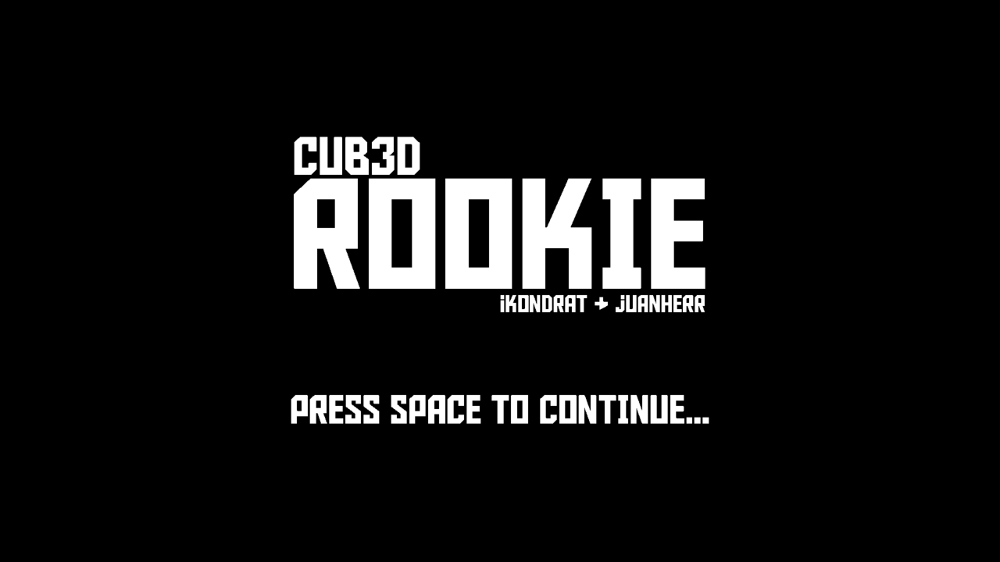
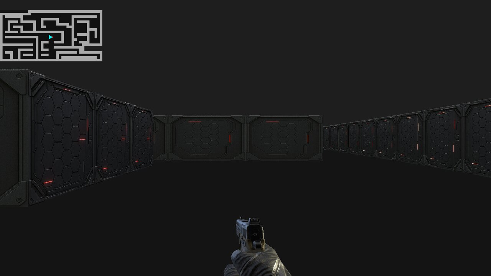

<h1 align="center">cub3D · <i>Rookie</i></h1>

<p align="center">
  A first-person 3D engine built from scratch in C with <b>raycasting</b>: no game engine, no GPU, just maths and pixels.
</p>

<p align="center">
  
</p>

<p align="center">
  
  
  
</p>

---

## ✨ Features

- **Raycasting renderer**: one ray per screen column, using the DDA algorithm to find the nearest wall and fish-eye correction to keep walls straight.
- **Textured walls** with a different texture for each orientation (north, south, east, west).
- **Mouse look**: turn left and right, and tilt the view up and down.
- **Live minimap** showing the player and their field of view.
- **Smooth movement** with wall collision.
- **Weapon overlay** and a **title screen**.
- **Map parser and validator** for `.cub` scene files: textures, floor and ceiling colours, and a check that the map is closed by walls.

<p align="center">
  
  
</p>

## 🧮 How raycasting works

The world is a 2D grid, but you see it in 3D. For every vertical column of the screen:

1. Cast a ray from the player at an angle inside the field of view (60°).
2. Step through the grid cell by cell (**DDA**) until the ray hits a wall.
3. Compute the **perpendicular distance** to that wall (using the raw distance would bend straight walls into a fish-eye).
4. Draw a vertical slice whose height is **inversely proportional to the distance**: far walls look small, near walls look big.
5. Pick the texture from the side that was hit and sample the right column of it.

Repeat 1,920 times per frame and you have a 3D world, the same trick early-90s games used to run on very modest hardware.

## 🚀 Build and run

Requirements: Linux with X11 development libraries (`libx11-dev`, `libxext-dev`), `gcc` and `make`.

```bash
make
./cub3D assets/rookie.cub
```

Other maps: `assets/mapa.cub`, `assets/mapa2.cub`.

## 🎮 Controls

| Key | Action |
|---|---|
| `Space` | Start from the title screen |
| `W` `A` `S` `D` | Move |
| `←` `→` or mouse | Turn |
| Mouse up/down | Look up and down |
| `Esc` | Quit |

## 🗺️ Scene files (`.cub`)

```
NO assets/textures/rookiewall01.xpm
SO assets/textures/rookiewall02.xpm
WE assets/textures/rookiewall03.xpm
EA assets/textures/rookiewall04.xpm

F 20, 20, 20
C 30, 30, 30

111111
100101
1010W1
111111
```

`NO`, `SO`, `WE`, `EA`: wall textures · `F`, `C`: floor and ceiling RGB · `1` wall · `0` floor · `N` `S` `E` `W` player start and facing.

## 📁 Structure

```
src/
├── main.c, init*.c                  setup and texture loading
├── parse_*.c, checkers.c            .cub parsing and map validation
├── raycasting*.c                    ray casting and DDA
├── render*.c, draw_gun.c            frame drawing, minimap, weapon
└── events.c, movement*.c, mouse_input.c   input and movement
```

## 👥 Authors

Made at **42 Madrid** by **juanherr** and **ikondrat**.
